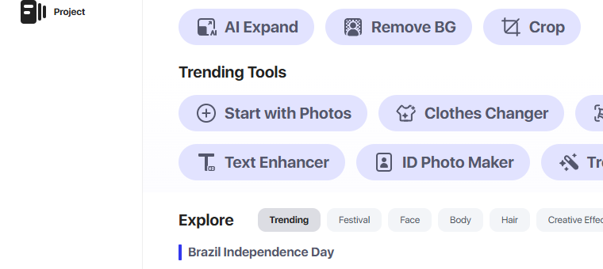
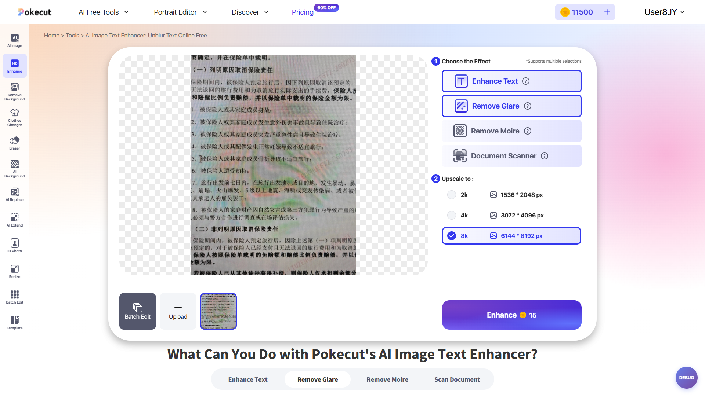
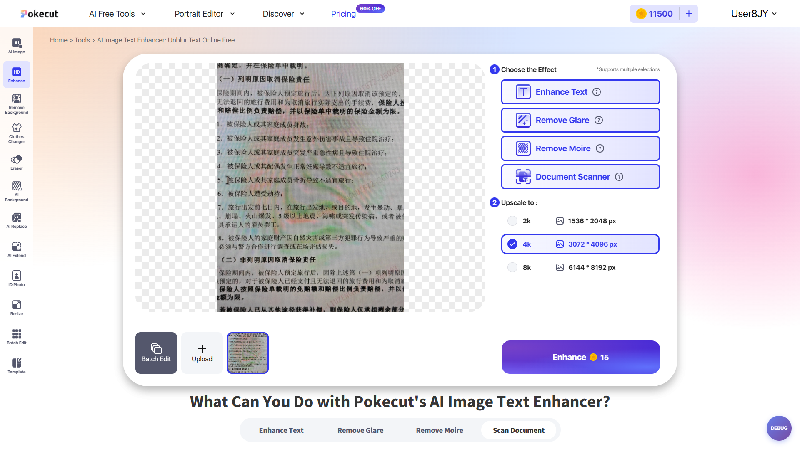
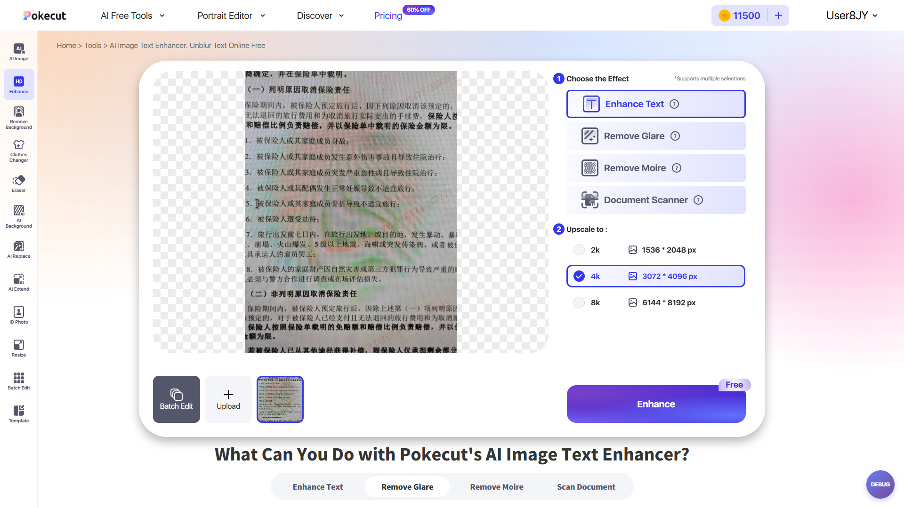

# 探索报告 — 稳定回归 3 个疑似漂移族局部复探

> 本报告为 **selector_drift 局部复探**的精简 human report（skill 豁免条款）：用户 2026-10-12 选择方案 A，授权只复探 3 个漂移族并回退修脚本，未做全量页面探索。

## 1. 任务概览

- 任务：`2026-10-12_stable_regression_registry`（`stable_regression` 局部回退 → `page-map-sync`）
- 目标环境：`http://10.17.1.66:3001/`
- 探索驱动：`playwright_mcp_only`（本会话 preflight 已通过）
- 范围：稳定回归 41 条失败归纳出的 3 个族（F1 画布文字入口 / F2 移动端购买链路 / F3 文字增强点数）
- 时间：2026-10-12 14:55 – 15:20

## 2. 探索范围与覆盖

| 页面 | 平台 | 覆盖状态 |
|---|---|---|
| `/create` | PC 1920x1080 | covered（入口卡） |
| `/agent?pid=<uuid>` | PC 1920x1080 | covered（左侧工具栏 + 文字面板） |
| `/en` 首页 header / credits 面板 | 移动端 390x844 iPhone | covered（注册入口） |
| `/tools/photo-enhancer` → `/create/edit?pid=` | 移动端 390x844 iPhone | covered（上传 → 提交 → 弹窗链路） |
| `/tools/ai-image-text-enhancer` | PC 1920x1080 | covered（点数矩阵） |

## 3. 关键入口与状态

| 覆盖点 | 稳定性 | selector / 入口 | 备注 |
|---|---|---|---|
| `/create` 入口卡 | 已漂移 | `button[data-tool-id='start-photo'][data-tool-surface='trending']` | 文案 `Start with Photos`；旧 `div.cursor-pointer:has-text('Start from a Photo')` 已失效 |
| 画布左侧工具栏 | 稳定 | `button[data-tool-id='text']` 等 7 个 | 未变，可继续复用 |
| 文字面板 Tab / 折叠区 | 稳定 | Basic / Adjust；Space / Reflection / Background / Outline | 未变 |
| SEO 上传入口（移动端） | 稳定 | `button.seo-first-screen-upload-button` | 未变 |
| 移动端主提交按钮 | 稳定 | `button.mobile-ai-generate-button` | 未变 |
| 移动端注册入口 | 已漂移 | `.credits-entry__pill` → `button.credits-entry__signup` | 旧 `button:has-text('Sign up')` 首页 0 命中 |
| 购买弹窗（促销/内购） | 稳定 | `.purchase-gift-modal` + `li.purchase-pro-plan__card` 计数区分 | 未变；关闭 `img[src*='nav_btn_pop_close.svg']` 有效 |
| 文字增强点数 | 行为变更 | `[data-text-enhance-total-cost]` / `data-text-enhance-cost-state` | 数值规则与基线不一致，待业务确认 |

## 4. Bug Candidate

**无。**

说明：本轮 3 个族分别是「页面漂移（F1/F2）」与「行为/计费变更（F3）」。F3 只有在业务确认新点数规则**非**预期时才转为 bug_candidate；在确认前不按缺陷处理，也不改写断言。

## 5. Gap / Skipped / Pending

| 类型 | 内容 |
|---|---|
| Gap | 无 |
| Skipped | 无（未因账号/数据/权限缺失去跳过任何覆盖点） |
| Pending | **D3 文字增强点数规则**：需业务/PRD 确认后再由 test-writing 更新 expected |
| Pending | 移动端 L4 会员档（预部署 450832596@qq.com 的 Free/Free/4 规则）本轮未复探，随 D3 一并确认 |

## 6. 自动化准备度

| 族 | 可修复性 | 需要的改动 |
|---|---|---|
| F1 | 可直接实现 | `tests/test_infinite_canvas_text_layer_v2.py::enter_canvas` 入口 selector 与文案替换（单点） |
| F2 | 可直接实现 | `tests/test_canvas_stats_all.py::register_or_login(mobile=True)` 注册入口替换；并取消 `except Exception: pass` 静默吞异常 |
| F3 | **阻塞** | 需业务确认点数规则；确认前不得改 expected（红线） |

未变 selector 可继续复用，无需重新设计用例。

## 7. 需要用户确认

1. **D3 点数规则**：`remove_glare/remove_moire/document_scanner` 由 2/2/4 变为统一 5，`enhance_text` 2k/4k 为 Free、8k 为 10，全效果 4k 为 15 —— 是否为预期变更（实验/AB 配置）？若不是，需提缺陷而非改脚本。
2. **F1/F2 修复授权**：确认后由 test-writing 只改 selector / 入口与异常处理，不改业务断言。
3. 确认后同步更新 `artifacts/regression_registry.md` 的 Page Map 列（→ v3 / v12 / v4）。

## 8. 已执行用例（按用例名标注）

- `AC-F1-1 /create 入口卡定位与上传` — bug_candidate（入口漂移，用例 `enter_canvas` 阻塞）
- `AC-F1-2 画布左侧工具栏 7 工具` — covered
- `AC-F1-3 文字面板 Adjust 工具栏` — covered
- `AC-F1-4 文字面板 Basic/Adjust Tab 与折叠区` — covered
- `AC-F2-1 移动端首页注册入口` — bug_candidate（入口漂移）
- `AC-F2-2 移动端 credits 面板注册路径` — covered
- `AC-F2-3 匿名态主提交弹窗` — covered（实测为注册弹窗，非购买弹窗）
- `AC-F2-4 注册态促销/内购弹窗链路` — covered
- `AC-F3-1 非增强单效果点数` — bug_candidate（行为差异，待确认）
- `AC-F3-2 enhance_text 点数` — bug_candidate（行为差异，待确认）
- `AC-F3-3 组合点数` — bug_candidate（行为差异，待确认）

> 本轮的 “bug_candidate” 标注指「与 confirmed 资产/基线不一致」，其中 F3 的定性仍取决于业务确认。

## 9. Bug Candidate 明细（可展开查看截图）

差异 D1｜`/create` 入口卡文案与元素类型变更（F1）
- [步骤] 打开 `http://10.17.1.66:3001/create` → 查看 Trending Tools 第一个入口卡 → 用旧 selector `div.cursor-pointer:has-text('Start from a Photo')` 定位
- [结果] 旧 selector 命中 0；实际存在 `button.create-tool-pill[data-tool-id='start-photo'][data-tool-surface='trending']`，文案 `Start with Photos`
- [期望] 入口卡可被稳定定位并能唤起文件选择器进入 `/agent?pid=<uuid>`

点击展开：/create Trending Tools 入口卡

差异 D2｜移动端注册入口迁移（F2）
- [步骤] 移动端 390x844 打开 `/en` → 查找 `button:has-text('Sign up')` → 点击 credits 胶囊展开面板 → 检查注册入口
- [结果] 首页 header 无 Sign up 按钮（0 命中）；credits 面板内为 `button.credits-entry__signup`（文案 `Sign up to get more`）
- [期望] 注册入口可被稳定定位并完成注册

点击展开：移动端首页 header（仅 credits 胶囊 + 汉堡）

点击展开：credits 面板内的新注册入口

差异 D2b｜匿名态点主提交弹注册弹窗（而非购买弹窗）
- [步骤] 匿名移动端 → `/tools/photo-enhancer` → 上传 1K.jpg → 点 `button.mobile-ai-generate-button`
- [结果] `.purchase-gift-modal` 计数 0，`[data-testid='auth-submit']` 出现 → 弹的是注册弹窗
- [期望] 用例期望出现购买弹窗（`wait_purchase_modal`）

点击展开：匿名态提交后的注册弹窗

对照 D2c｜注册态促销弹窗 → 关闭 → 内购弹窗（链路正常）
- [步骤] 用新入口注册 → 同一入口上传并提交 → 观察弹窗
- [结果] 促销弹窗（`mobile-sales-promotion-dialog`，套餐卡 0）→ 点 `img[src*='nav_btn_pop_close.svg']` → 内购弹窗（套餐卡 3）

点击展开：促销弹窗

点击展开：关闭促销后的内购弹窗

差异 D3｜文字增强点数规则（F3）
- [步骤] `/tools/ai-image-text-enhancer` → 上传 `test_images/文字测例.jpg` → 逐个切换效果与 2k/4k/8k
- [结果] 见同步文档 §3 D3 矩阵；非增强单效果统一 5、enhance_text 2k/4k 为 Free、全效果 4k 为 15
- [期望] 基线为 2 / 2 / 4 / 6 / 14

点击展开：非增强单效果 paid 5

点击展开：全效果 4k 计 15

点击展开：enhance_text 免费额度态 Free

## 10. 未执行用例（按用例名标注）

### 10.1 Gap

无。

### 10.2 Skipped

无。

> 本轮只复探 3 个漂移族；稳定回归报告中的其余失败（移动端首页 L3-004、SEO 上传 L2-011 服务端繁忙、移动端 SEO L2-005/L2-006、canvas_stats 埋点漏报 P-INF-02/03、P-NEW-03/16、M-CORE-02/06/07）不在本轮复探授权范围内，保持原样待后续处理。
